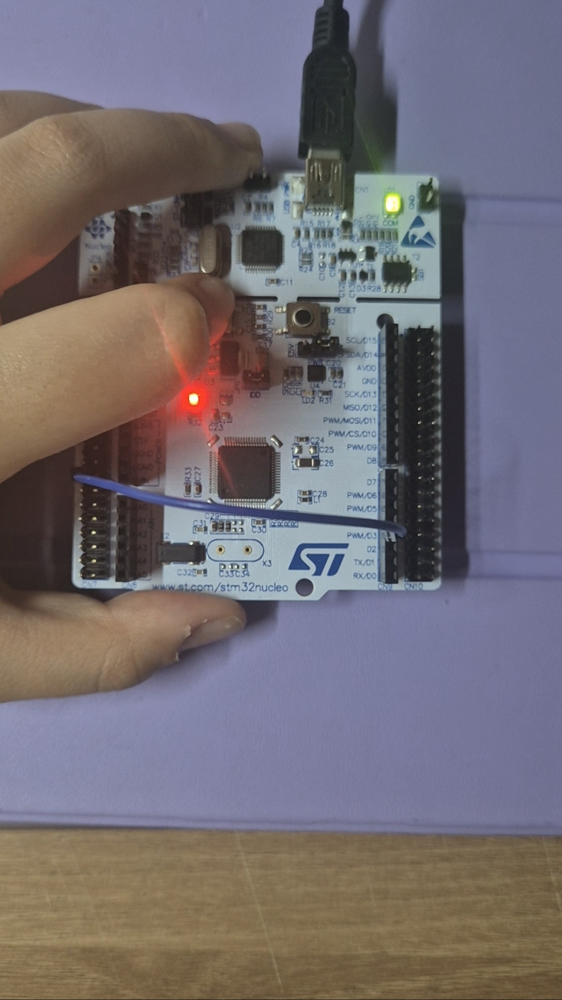
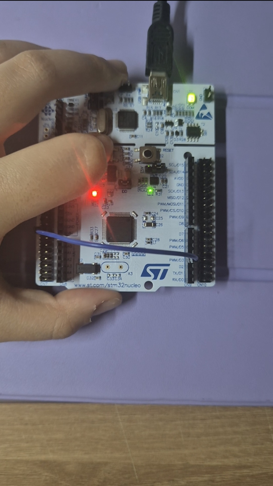
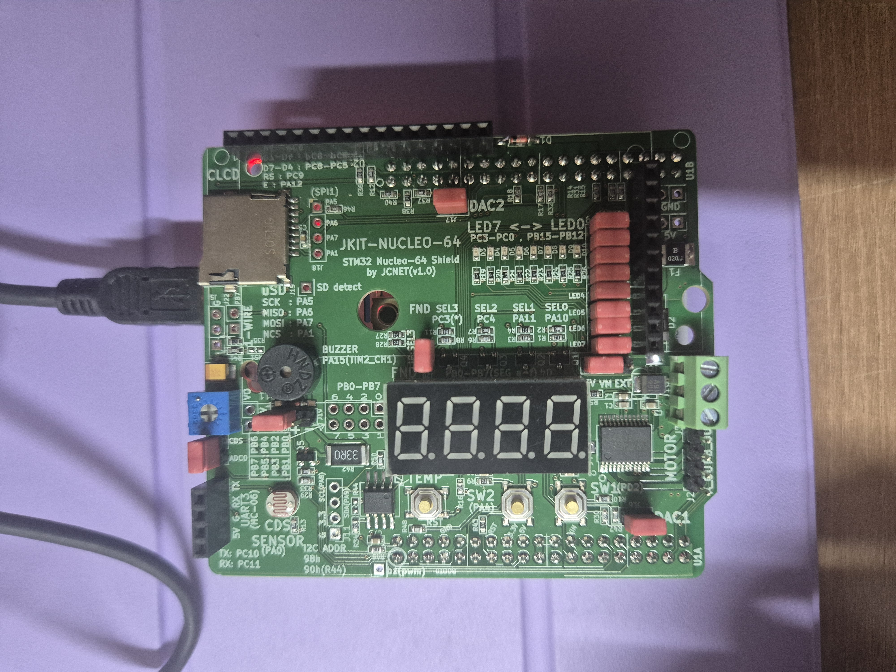
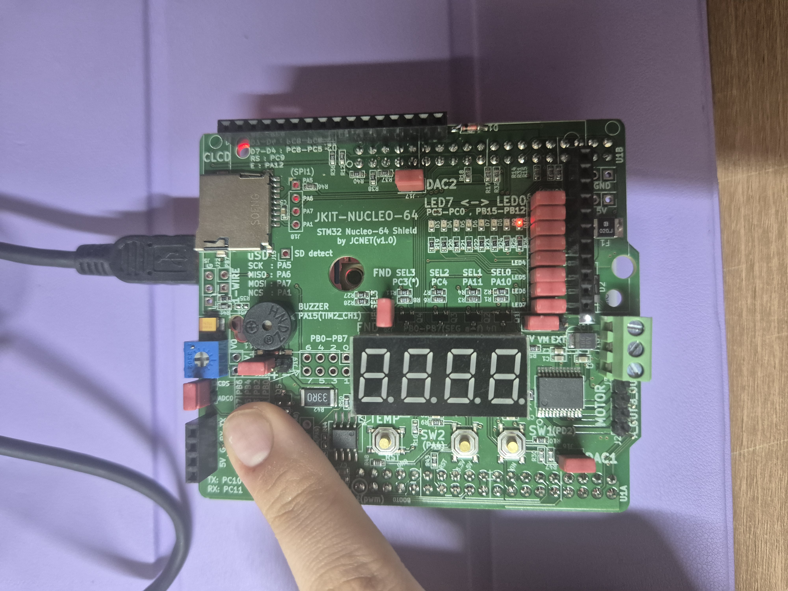
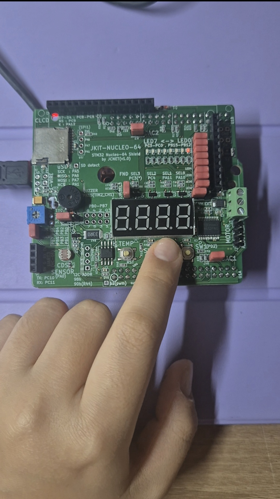
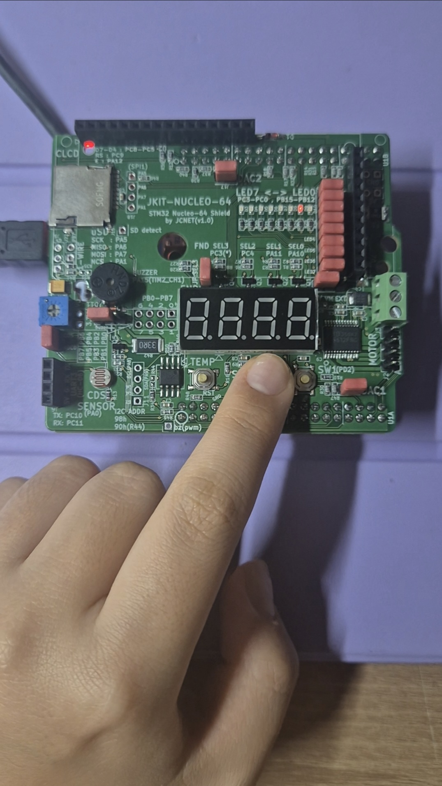
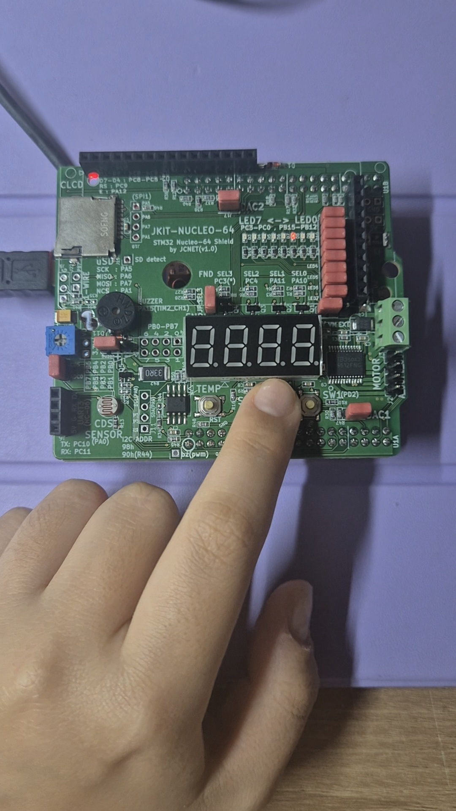
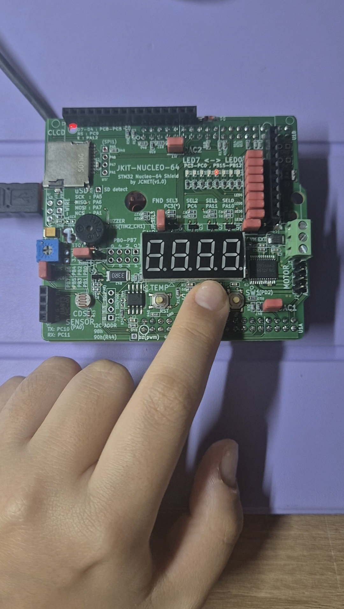

# LAB: GPIO Digital InOut(eval board)

## LAB: GPIO Digital InOut

**Date:** 2026-09-21

**Author/Partner:** 손수현

**Demo Video:** [demo video link](https://youtube.com/shorts/DvHm3brbWZU)


## Introduction

In this lab, you are required to create a simple program that toggles multiple LEDs using a push-button input.

You must create your own drivers for GPIO digital input and output control.

### Requirement

#### Hardware

* MCU
  * NUCLEO-F411RE
* Eval Board
* Actuator/Sensor/Others:

#### Software

* PlatformIO, CMSIS, EC\_HAL library

***

## Problem 0: STM-Arduino

We are going to create a simple program that turns LED(LD2) on and off by pressing the user button(BT1), using Arduino Syntax

### Example code

```cpp
const int btnPin = 3;
const int ledPin = 13;

int btnState = HIGH;

void setup() {
  pinMode(ledPin, OUTPUT);
  pinMode(btnPin, INPUT);
}

void loop() {
  btnState = digitalRead(btnPin);

  if (btnState == HIGH) 
    digitalWrite(ledPin, LOW);
  
  else 
    digitalWrite(ledPin, HIGH);
  
}
```

***

## Problem 1: Create EC\_HAL library

### Procedure

#### Function Definitions

Fill-in the blanks in the header files to complete the definitions for the provided functions

**ecGPIO2_22400365.h**

```cpp
void GPIO_init(PinName_t pinName, uint32_t mode);     
void GPIO_mode(PinName_t pinName, uint32_t mode);
void GPIO_ospeed(PinName_t pinName, uint32_t speed);
void GPIO_otype(PinName_t pinName, uint32_t type);
void GPIO_pupd(PinName_t pinName, uint32_t pupd);
void GPIO_write(PinName_t pinName, uint32_t Output);
uint32_t  GPIO_read(PinName_t pinName);
```

* Example code in **ecGPIO2_22400365.c**

```cpp
// Input(00), Output(01), AlterFunc(10), Analog(11, reset)
void GPIO_init(PinName_t pinName, uint32_t mode){     
	GPIO_TypeDef * Port;
	unsigned int pin;
	ecPinmap(pinName, &Port, &pin);
	
	// mode  : Input(0), Output(1), AlterFunc(2), Analog(3)   
	if (Port == GPIOA)
		RCC_GPIOA_enable();
	if (Port == GPIOB)
		RCC_GPIOB_enable();
	
	// Make it for GPIOC, GPIOD..GPIOH
	if (Port == GPIOC)
		RCC_GPIOC_enable();
	if (Port == GPIOD)
		RCC_GPIOD_enable();
	if (Port == GPIOE)
		RCC_GPIOE_enable();
	if (Port == GPIOH)
		RCC_GPIOH_enable();
	//
	// You can also make and use a more general function of
	// void RCC_GPIO_enable(GPIO_TypeDef *Port); 

	GPIO_mode(pinName, mode);
}


// GPIO Mode          : Input(00), Output(01), AlterFunc(10), Analog(11)
void GPIO_mode(PinName_t pinName, uint32_t mode){
 	GPIO_TypeDef *port;
	unsigned int pin;
	ecPinmap(pinName, &port, &pin);
    
	port->MODER &= ~(3UL<<(2*pin));     
	port->MODER |= mode<<(2*pin);    
}


// GPIO Speed          : Low speed (00), Medium speed (01), Fast speed (10), High speed (11)
void GPIO_ospeed(PinName_t pinName, uint32_t speed){
	GPIO_TypeDef * Port;
	unsigned int pin;
	ecPinmap(pinName,&Port,&pin);

	Port->OSPEEDR &= ~(3UL<<(2*pin));
  Port->OSPEEDR |= speed<<(2*pin);                   

}

// GPIO Output Type: Output push-pull (0, reset), Output open drain (1)
void GPIO_otype(PinName_t pinName, uint32_t type){
	GPIO_TypeDef * Port;
	unsigned int pin;
	ecPinmap(pinName,&Port,&pin);

  Port->OTYPER &=  ~(1UL<<pin) ;           
  Port->OTYPER |= type << pin;                           

}

// GPIO Push-Pull    : No pull-up, pull-down (00), Pull-up (01), Pull-down (10), Reserved (11)
void GPIO_pupd(PinName_t pinName, uint32_t pupd){
	GPIO_TypeDef * Port;
	unsigned int pin;
	ecPinmap(pinName,&Port,&pin);

    Port->PUPDR &= ~(3UL<<(2*pin)); 
    Port->PUPDR  |=  pupd<<(2*pin);
}


void GPIO_write(PinName_t pinName, uint32_t Output){
	GPIO_TypeDef *Port;
	unsigned int pin;
	ecPinmap(pinName, &Port, &pin);

  Port->ODR &= ~(1UL << pin);
	Port->ODR |= Output << pin;    
}


uint32_t GPIO_read(PinName_t pinName){
	GPIO_TypeDef * Port;
	unsigned int pin;
	ecPinmap(pinName,&Port,&pin);

	uint32_t val=0;

  val = (Port->IDR >> pin) & 1UL;

  return val;
}
```

***

## Problem 2: Toggle a single LED with Digital Sensor(Photodetector)

### Problem

Toggle the LED by covering the photodetector sensor.

* Dark (LED ON), Bright (LED OFF) and repeat
* Connect the Photodetector sensor to PA\_0 pin on Nucleo Board.

### Configuration

Configure the MCU GPIO

| Function                  | Port - Pin | Configuration                                               |
| ------------------------- | ---------- | ----------------------------------------------------------- |
| **Photodetector on JKIT** | PA\_0      | Digital IN, Pull-Up                                         |
| **LED0**                  | PB\_12     | <p>Digital OUT, Pull-UP,</p><p>Open-Drain, Medium Speed</p> |

### Code

Explain your source code with necessary comments.

```cpp
/*----------------------------------------------------------------\
@ Embedded Controller by Young-Keun Kim - Handong Global University
Author           : 손수현
Created          : 05-03-2021
Modified         : 17-09-2026
Language/ver     : C++ in VS Code

Description      : First Lab _ Problem 2
/----------------------------------------------------------------*/

#include "ecRCC2.h"
#include "ecGPIO2_22400365.h"

#define LED_PIN PB_12
#define BUTTON_PIN PA_0


// Initialiization 
void setup(void) {
	RCC_HSI_init();
	// initialize the pushbutton pin as an input:
	GPIO_init(BUTTON_PIN, INPUT);
	GPIO_pupd(BUTTON_PIN,PU);
	// initialize the LED pin as an output:
	GPIO_init(LED_PIN, OUTPUT);   
	GPIO_pupd(LED_PIN, PU);
	GPIO_otype(LED_PIN, OPEN_DRAIN);
	GPIO_ospeed(LED_PIN, MEDIUM_SPEED);
}
	
int main(void) { 
 	setup();
	int buttonState=0;
	
	while(1){
		// check if the pushbutton is pressed. Turn LED on/off accordingly:
		buttonState = GPIO_read(BUTTON_PIN);
		if(buttonState)	GPIO_write(LED_PIN, LOW);
		else 		GPIO_write(LED_PIN, HIGH);
		delay_ms_HSI(100);             					// delay 100 ms
	}
}
```

## Problem 3: Toggle multiple LEDs with a button

### Problem

Use the four LEDs (LED0 to LED3) on the JKIT evaluation board.

Each time Button B1 is pressed, turn on one LED at a time in a sequential loop

* e.g., LED0 -> LED1 -> LED2 -> LED3 -> LED0)

### Configuration

| Function           | Port - Pin                     | Configuration                                               |
| ------------------ | ------------------------------ | ----------------------------------------------------------- |
| **SW2 on JKIT**    | PA\_4                          | Digital IN, Pull-Up                                         |
| **LED\_0\~LED\_3** | PB\_12, PB\_13, PB\_14, PB\_15 | <p>Digital OUT, Pull-UP,</p><p>Open-Drain, Medium Speed</p> |


### Code

```
/*----------------------------------------------------------------\
@ Embedded Controller by Young-Keun Kim - Handong Global University
Author           : 손수현
Created          : 05-03-2021
Modified         : 17-09-2026
Language/ver     : C++ in VS Code

Description      : First Lab _ Problem 3
/----------------------------------------------------------------*/
#include "ecRCC2.h" 
#include "ecGPIO2_22400365.h" 
 
// SW2 
#define SW2_PIN     PA_4 
 
// LED0 ~ LED3 
#define LED0_PIN    PB_12 
#define LED1_PIN    PB_13 
#define LED2_PIN    PB_14 
#define LED3_PIN    PB_15 
 
void setup(void); 
 
int main(void) 
{ 
    setup(); 
 
    int ledState = 0; 
    int buttonState = 1; 
    int prevButtonState = 1; 
 
    while(1) 
    { 
        // Read SW2 
        buttonState = GPIO_read(SW2_PIN); 
 
        // Detect button press (HIGH -> LOW) 
        if(prevButtonState == 1 && buttonState == 0) 
        { 
            // Move to next LED 
            ledState++; 
 
            if(ledState > 3) 
                ledState = 0; 
 
            // Turn OFF all LEDs
            // Active-High : LOW = OFF
            GPIO_write(LED0_PIN, LOW); 
            GPIO_write(LED1_PIN, LOW); 
            GPIO_write(LED2_PIN, LOW); 
            GPIO_write(LED3_PIN, LOW); 
 
            // Turn ON only selected LED
            // Active-High : HIGH = ON
            if(ledState == 0) 
                GPIO_write(LED0_PIN, HIGH); 
            else if(ledState == 1) 
                GPIO_write(LED1_PIN, HIGH); 
            else if(ledState == 2) 
                GPIO_write(LED2_PIN, HIGH); 
            else if(ledState == 3) 
                GPIO_write(LED3_PIN, HIGH); 
 
            // Debouncing 
            delay_ms_HSI(100); 
        } 
 
        prevButtonState = buttonState; 
    } 
} 
 
 
// Initialization 
void setup(void) 
{ 
    RCC_HSI_init(); 
 
    // SW2 : PA4, Digital IN, Pull-Up 
    GPIO_init(SW2_PIN, INPUT); 
    GPIO_pupd(SW2_PIN, PU); 
 
    // LED0 : PB12 
    GPIO_init(LED0_PIN, OUTPUT); 
    GPIO_pupd(LED0_PIN, PU); 
    GPIO_otype(LED0_PIN, OPEN_DRAIN); 
    GPIO_ospeed(LED0_PIN, MEDIUM_SPEED); 
 
    // LED1 : PB13 
    GPIO_init(LED1_PIN, OUTPUT); 
    GPIO_pupd(LED1_PIN, PU); 
    GPIO_otype(LED1_PIN, OPEN_DRAIN); 
    GPIO_ospeed(LED1_PIN, MEDIUM_SPEED); 
 
    // LED2 : PB14 
    GPIO_init(LED2_PIN, OUTPUT); 
    GPIO_pupd(LED2_PIN, PU); 
    GPIO_otype(LED2_PIN, OPEN_DRAIN); 
    GPIO_ospeed(LED2_PIN, MEDIUM_SPEED); 
 
    // LED3 : PB15 
    GPIO_init(LED3_PIN, OUTPUT); 
    GPIO_pupd(LED3_PIN, PU); 
    GPIO_otype(LED3_PIN, OPEN_DRAIN); 
    GPIO_ospeed(LED3_PIN, MEDIUM_SPEED); 
 
    // Initial LED state : LED0 ON
    // Active-High : HIGH = ON, LOW = OFF
    GPIO_write(LED0_PIN, HIGH); 
    GPIO_write(LED1_PIN, LOW); 
    GPIO_write(LED2_PIN, LOW); 
    GPIO_write(LED3_PIN, LOW); 
}
```

### Results

> Show experiment images /results

<p align="center">
 
</p>

<p align="center">
 
</p>

<p align="center">
 
</p>

<p align="center">
 
</p>

Add [demo video link](https://youtube.com/shorts/DvHm3brbWZU)

### Discussion

1. Find out a typical solution for software debouncing and hardware debouncing.
2. What method of debouncing did this NUCLEO board use for the push-button(B1)?

> Answer discussion questions

1. Software debouncing removes button bouncing by ignoring input changes for a short period after detecting a button press. A delay or timer can be used for this purpose. Hardware debouncing removes bouncing electrically using circuits such as an RC low-pass filter or a Schmitt trigger.

2. The NUCLEO-F411RE uses hardware debouncing with an RC low-pass filter. The B1 circuit uses a 4.7 kΩ pull-up resistor (R30) and a 100 nF capacitor (C15), giving an RC time constant of approximately 0.47 ms.

## Reference

https://rorsi.tistory.com/29


