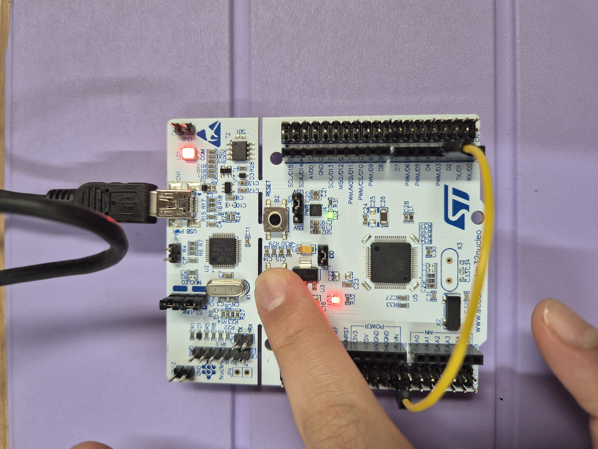
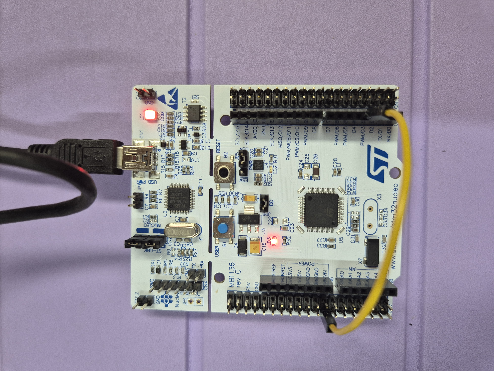
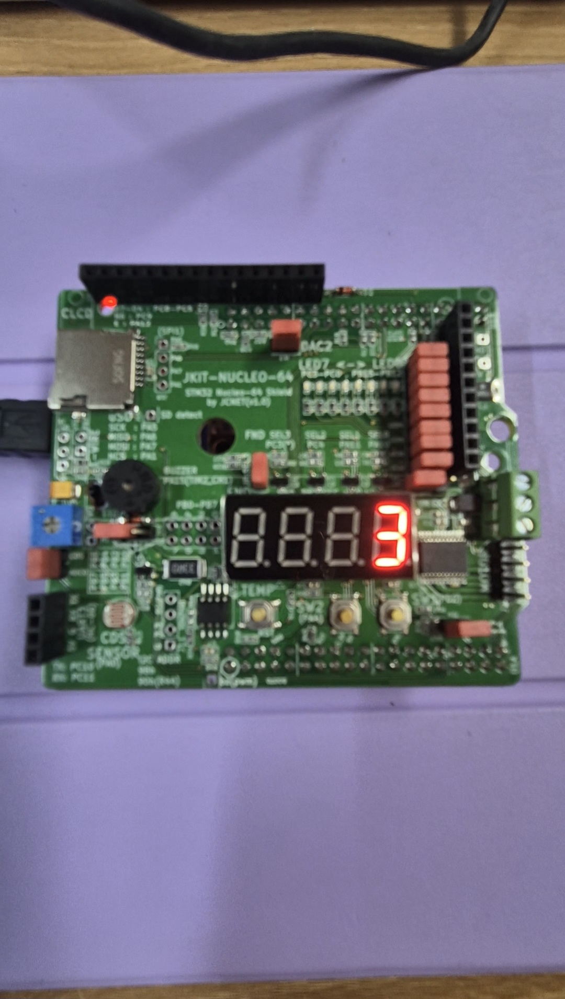

# LAB_EXTI

##

**Date:** 2026-10-07

**Author:** Suhyun Son

**Demo Video:** [demo video link](https://youtube.com/shorts/uSKnCsVhvko?feature=share)

***


## Problem 0: STM-Arduino

#### Code

```c
const int btnPin = 3;
const int ledPin =  13; 

int btnState = HIGH;

void setup() {
    pinMode(ledPin, OUTPUT);
    pinMode(btnPin, INPUT_PULLUP);
    attachInterrupt(digitalPinToInterrupt(btnPin), blink, CHANGE);
}

void loop() {
    // blank
}


void blink(){
    btnState = digitalRead(btnPin);

    if (btnState == HIGH)
        digitalWrite(ledPin, LOW);
    else 
        digitalWrite(ledPin, HIGH);
}
```

#### Results

<div align="center">
   <br>
  Figure 1. Result of Problem 0
</div>

PC13, which is connected to the user button, was connected to Arduino pin D3 using a jumper wire for external interrupt operation.

## Prelab: EXTI Register Setting

#### EXTI Functions

```c
void EXTI_init(PinName_t pinName, uint32_t trig_type, uint32_t priority);
void EXTI_enable(uint32_t pin);  // mask in IMR
void EXTI_disable(uint32_t pin);  // unmask in IMR
uint32_t  is_pending_EXTI(uint32_t pin);
void clear_pending_EXTI(uint32_t pin);
```

#### Explanation 

In the PreLAB, the EXTI library was implemented to configure and control external interrupts. The following functions were declared in ecEXTI.h, and their corresponding implementations were defined in ecEXTI.c.

## Problem 1: Counter on 7-Segment display using EXTI

#### Problem

The main function repeatedly counts from 0 to 9 at one-second intervals using delay_ms().
When SW2 is pressed, an external interrupt toggles the pause state to pause or resume the counting.
When SW1 is pressed, an external interrupt resets the counter value to zero.

#### Configuration

| Function | Port - Pin | Configuration |
| :---: | :---: | :---: |
| **Button (SW1)** | PD_2 | DIN, Pull-Up |
| **Button (SW2)** | PA_4 | DIN, Pull-Up |
| **7-Segment DOUT** | PB_0 ~ PB_7 (a ~ g, dot) | DOUT, Push-Pull, No Pull-up/Pull-down, Medium Speed |
| **7-Segment Selection** | PA_10 (FND_0) | DOUT, Push-Pull |

#### Code

```c
#include "ecSTM32F4v2_22400365.h"

#define LED0_PIN   PB_12 		//EVAL board JKIT LED0
#define SW2_PIN    PA_4			//EVAL board JKIT SW2
#define SW1_PIN    PD_2         //EVAL board JKIT SW1


// void led_toggle(PinName_t pinName);  // in ecGPIO2.h

// Pin Definition
PinName_t pinFND[8]    = {PB_0, PB_1, PB_2, PB_3, PB_4, PB_5, PB_6, PB_7};
PinName_t selectFND[4] = {PA_10, PA_11, PC_4, PC_3};

// Initialization 
void setup(void)
{
    RCC_PLL_init();                 // System Clock = 84MHz
    SysTick_init();                 // SysTick Timer Initialization
    // Initialize GPIOB_12 for Output
    GPIO_init(LED0_PIN, OUTPUT);    // LED0 for EVAL board	

    // Initialize GPIOA_4 for Input Button
    GPIO_init(SW2_PIN, INPUT);  // INPUT for EVAL board
    GPIO_pupd(SW2_PIN, PU);  // PULL-UP for EVAL board

    // Initialize EXTI PA_4
    EXTI_init(SW2_PIN, FALL, 10);
    
    // Initialize GPIOD_2 for Input Button
    GPIO_init(SW1_PIN, INPUT);  // INPUT for EVAL board
    GPIO_pupd(SW1_PIN, PU);  // PULL-UP for EVAL board

    // Initialize EXTI PD_2
    EXTI_init(SW1_PIN, FALL, 10);
    
    // Initialize 7-Segment Display
    FND_init(pinFND);
    FND_select_init(selectFND);
}


// Initialization
volatile int count = 0;
volatile int pause = 0;

// MAIN  ----------------------------------------
int main(void) {
	setup();
	while (1){

        // 7-Segment Display Setting
        FND_select(0);
        FND_display(count);

        // Count Up When Not Paused
        if (pause == 0){
            count++;
            if (count > 9){
                count = 0;
            }
    }

    // Value changes every second
    delay_ms(1000);

    }
}

// SW2 Interrupt: Pause/Resume Counting
void EXTI4_IRQHandler(void) {
	if (is_pending_EXTI(SW2_PIN)) {   
			pause = !pause;
			clear_pending_EXTI(SW2_PIN);
	}
}

// SW1 Interrupt: Reset Counter
void EXTI2_IRQHandler(void) {
    if(is_pending_EXTI(SW1_PIN)){
        count=0;
        clear_pending_EXTI(SW1_PIN);
    }
}
```

#### Results

<div align="center">
  <br>
  Figure 2. Representative result of Problem 1
</div>

[demo video link](https://youtube.com/shorts/uSKnCsVhvko?feature=share)

## Discussion

1\. Analyze the result and explain any other necessary discussion.

  In Problem 0, LD2 was turned on when B1 was pressed and turned off when B1 was released, confirming that the external interrupt operated correctly.
  In Problem 1, the 7-segment display repeatedly counted from 0 to 9 at one-second intervals. SW1 and SW2 were configured as pull-up inputs, so the input changes from HIGH to LOW when each button is pressed. Therefore, the external interrupts were configured to detect the falling edge.
  When SW2 was pressed, the EXTI4 interrupt was generated and EXTI4_IRQHandler() changed the pause state. As a result, the main loop paused or resumed the counting according to the value of pause. When SW1 was pressed, the EXTI2 interrupt was generated and EXTI2_IRQHandler() reset count to zero. After handling each interrupt, the pending flag was cleared to complete the interrupt handling.

2\. We can use two different methods to detect an external signal: polling and interrupt. What are the advantages and disadvantages of each approach?

  The interrupt method allows the CPU to focus on critical tasks without incurring unnecessary idle time and enables real-time processing by responding immediately to events. However, frequent interrupts cause repeated CPU interruptions, leading to performance degradation. Additionally, complexity increases because priority settings are required when multiple interrupts occur simultaneously.
  In contrast, polling involves simpler code and easier debugging compared to the interrupt method, as it eliminates the need to manage complex structures like interrupt priorities or nested interrupts. It also maintains a predictable execution flow. However, since the CPU continuously checks devices even when no events occur, it results in excessive operations and increased power consumption. Furthermore, systems requiring rapid responses may miss events, and the method is inefficient when handling multiple devices.

3\. What would happen if the EXTI interrupt handler does not clear the interrupt pending flag? Check with your code

  When clear_pending_EXTI(SW2_PIN) was used, the pending flag was cleared after the SW2 interrupt was handled, allowing the program to return to the main function. When SW2 was pressed again, a new interrupt was generated and the pause state was changed again.
  To check the result without clearing the pending flag, clear_pending_EXTI(SW2_PIN) was commented out. In this case, the pending flag remained set after SW2 was pressed. Therefore, the interrupt request remained pending and the interrupt handler was repeatedly executed instead of returning to normal main-loop operation. Pressing SW2 again did not restore the normal operation because the previous interrupt request had not been cleared.

### Reference

```
https://share.google/lGBMeUMWtOEPjB0pT
```