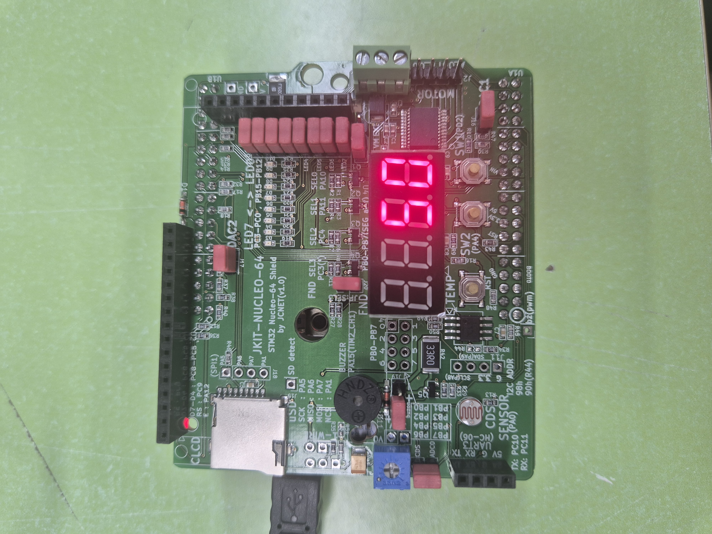
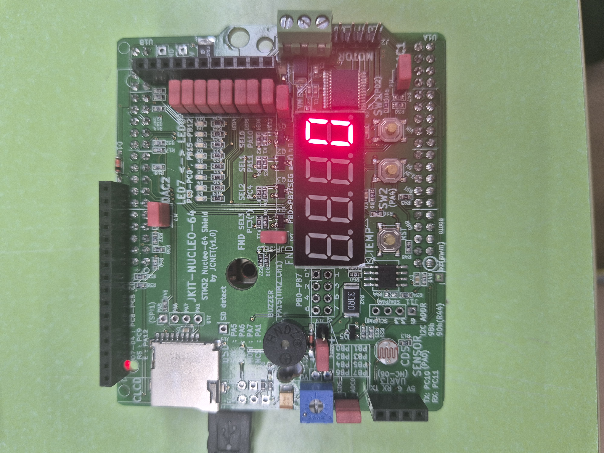
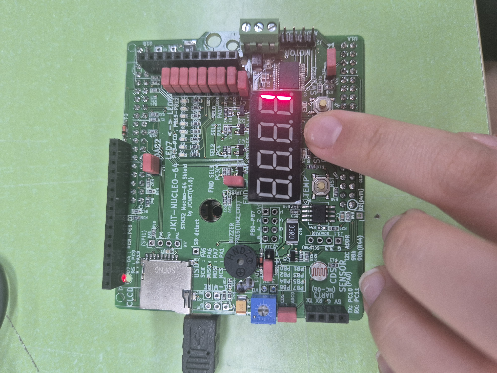
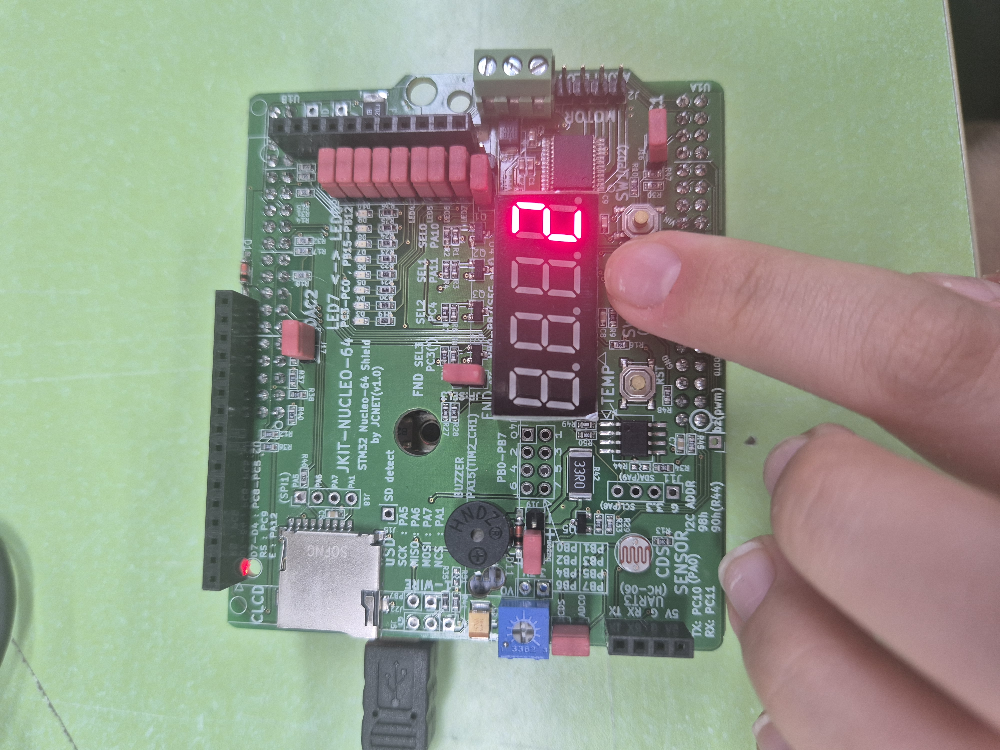
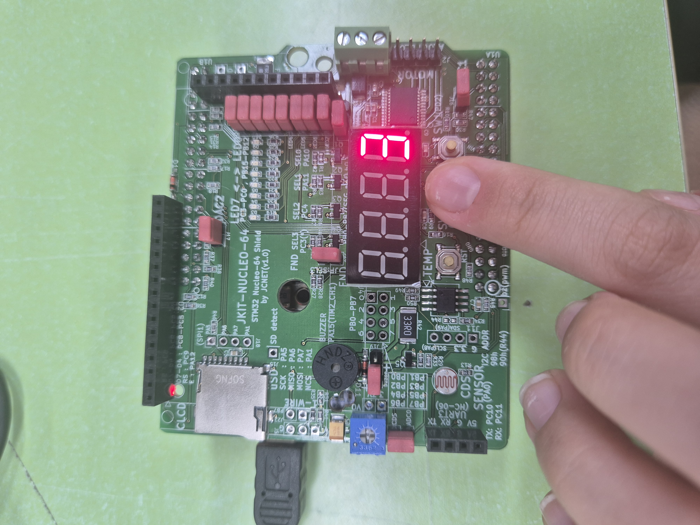
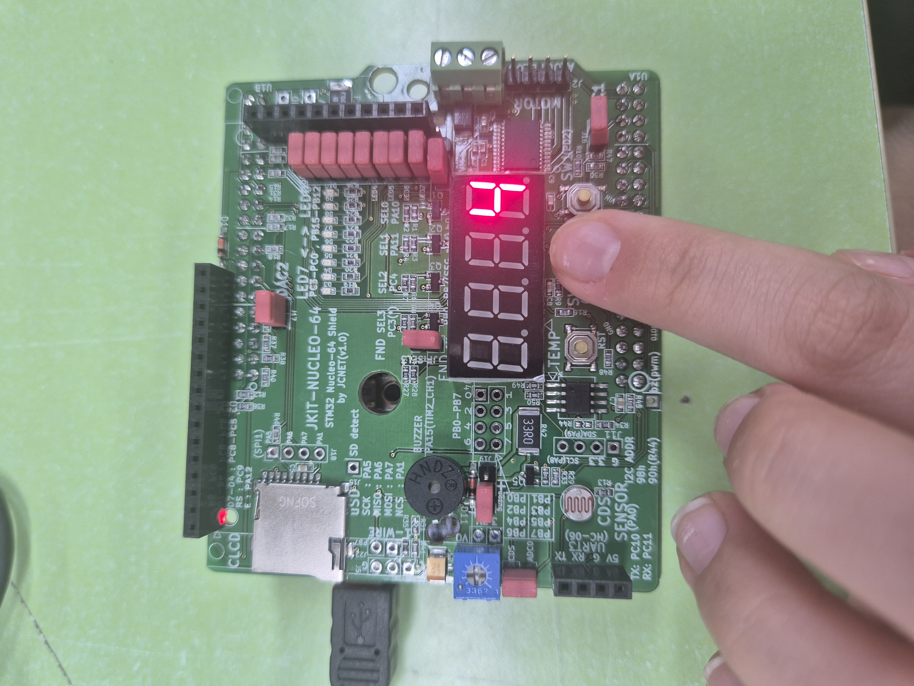
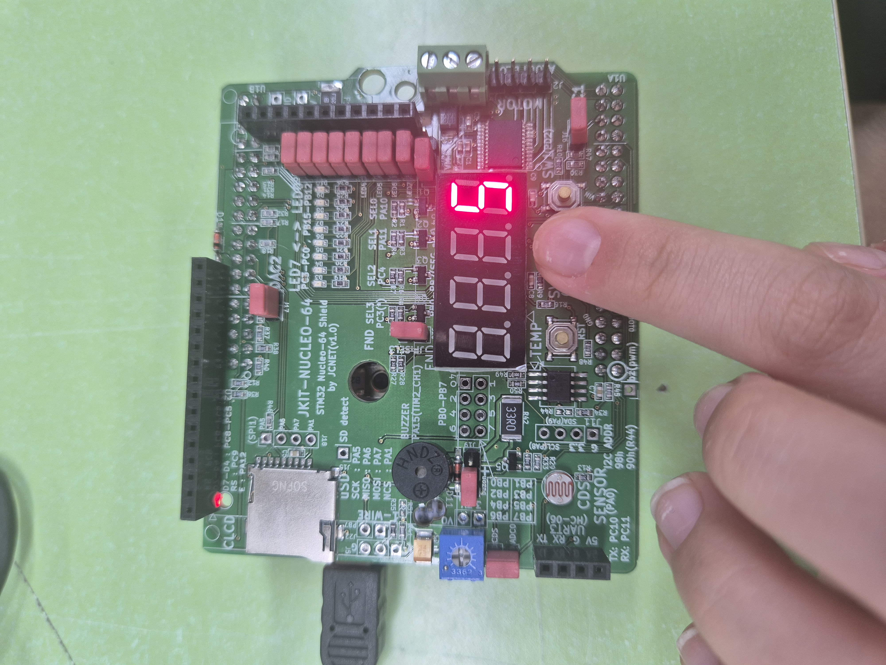
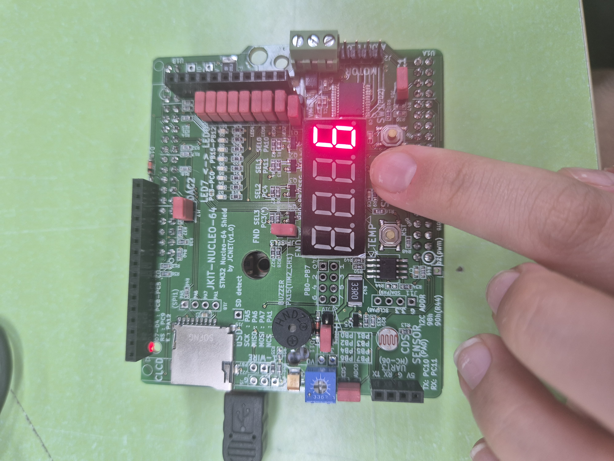
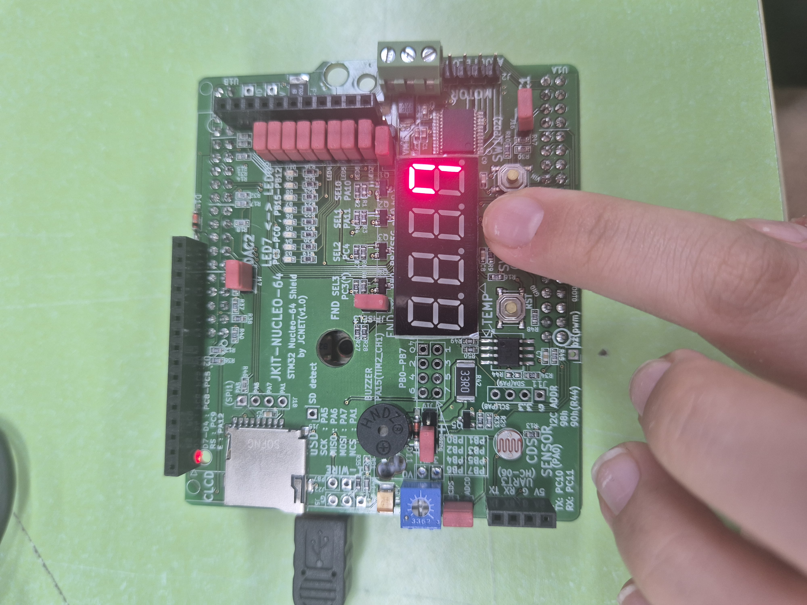
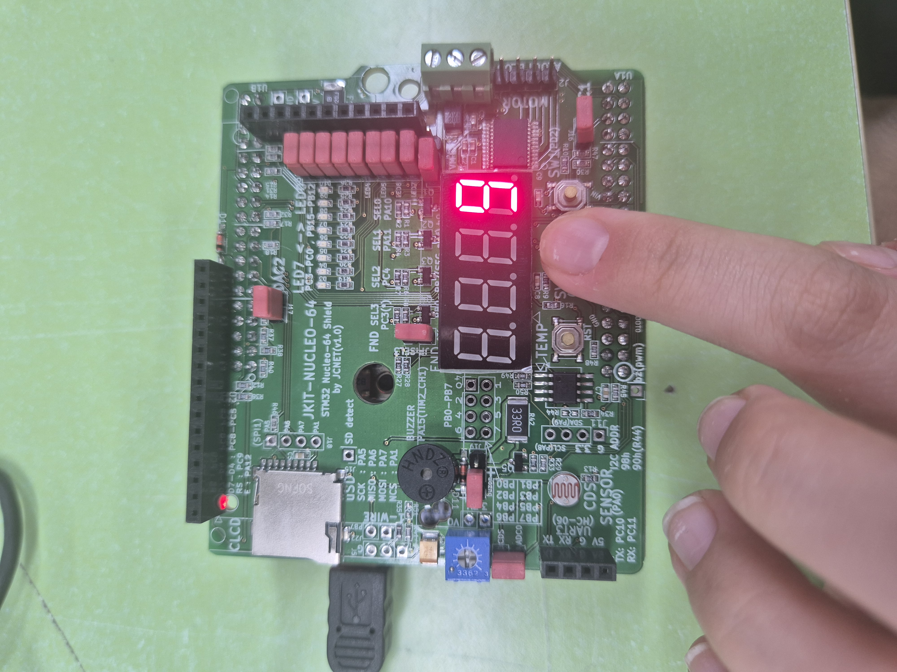

# LAB: GPIO 7-segment

**Date:** 2026-09-23

**Author:** 손수현

**Demo Video:** [demo video link](https://youtube.com/shorts/6OMifbLKoto)


## Introduction

In this lab, you are required to create a simple program to control a 7-segment display to show a decimal number (0\~9) that increases by pressing a push-button.

**Requirement**

**Hardware**

* MCU
  * NUCLEO-F411RE
* Actuator/Sensor/Others:
  * eval board

**Software**

* PlatformIO, CMSIS, EC\_HAL library

### Exercise
| **Port/Pin**   | **Description**                | **Register setting**                                         |
| -------------- | ------------------------------ | ------------------------------------------------------------ |
| Port B Pin 5   | Clear Pin5 mode                | GPIOB->MODER &= ~(3<<(5*2))                                  |
| Port B Pin 5   | Set Pin5 mode = Output         | GPIOB->MODER |= (1<<(5*2))                                   |
| Port B Pin 6   | Clear Pin6 mode                | GPIOB->MODER &= ~(3<<(6*2))                                  |
| Port B Pin 6   | Set Pin6 mode = Output         | GPIOB->MODER |= (1<<(6*2))                                   |
| Port B Pin Y   | Clear PinY mode                | GPIOB->MODER &= ~(3<<(Y*2))                                  |
| Port B Pin Y   | Set PinY mode = Output         | GPIOB->MODER |= (1<<(Y*2))                                   |
| Port B Pin 5~9 | Clear Pin5~9 mode              | GPIOB->MODER &= ~(0x3FF<<(5*2))                              |
|                | Set Pin5~9 mode = Output       | GPIOB->MODER |= (0x155<<(5*2))                               |
| Port X Pin Y   | Clear Pin Y mode               | GPIOX->MODER &= ~(3<<(Y*2))                                  |
|                | Set Pin Y mode = Output        | GPIOX->MODER |= (1<<(Y*2))                                   |
| Port B Pin5    | Set Pin5 otype = push-pull     | GPIOB->OTYPER &= ~(1<<5)                                     |
| Port B PinY    | Set PinY otype = push-pull     | GPIOB->OTYPER &= ~(1<<Y)                                     |
| Port B Pin5    | Set Pin5 ospeed = Fast         | GPIOB->OSPEEDR = (GPIOB->OSPEEDR & ~(3<<(5*2))) | (2<<(5*2)) |
| Port B PinY    | Set PinY ospeed = Fast         | GPIOB->OSPEEDR = (GPIOB->OSPEEDR & ~(3<<(Y*2))) | (2<<(Y*2)) |
| Port B Pin 5   | Set Pin5 PUPD = no pullup/down | GPIOB->PUPDR &= ~(3<<(5*2))                                  |
| Port B Pin Y   | Set PinY PUPD = no pullup/down | GPIOB->PUPDR &= ~(3<<(Y*2))                                  |
***

## Problem 1. Library for 7-segment display on JKIT Board

#### Problem

There are four 7-Segment Displays on JKIT board.

* You need to select which one to use.
* There is no BCD decoder
* JKIT - Nucleo 64: [link](https://www.devicemart.co.kr/goods/view?no=14123215\&srsltid=AfmBOooT3zgaxGXZ_q0fvy4uZxHesTbwpqNprE6P3YXMk9V0EGoGrhLM)

<figure><figcaption></figcaption></figure>

Complete the required functions that displays numbers on 7-segment FND.(JKIT - Nucleo 64)

These functions are defined and declared in `ecGPIO2.h, ecGPIO2.c`

```c
// Display a number 0 - 9 only
void FND_display_init(PinName_t *pinFND);
void FND_display(uint8_t  num)

// Select display: FND0 to FND3
void FND_select_init(PinName_t *selectFND);
void FND_select(uint8_t select);
```

**Configuration**

<div align="center"> </div>

| **Function** | **Port - Pin** | **Configuration** |
|---|---|---|
| **Selection of 7-Segment Display** | PA_10, PA_11, PC_4, PC_3 (FND_0~FND_3) | DOUT, Push-Pull |
| **7-Segment LEDs** | PB_0, PB_1, PB_2, PB_3, PB_4, PB_5, PB_6, PB_7 ('a'~'g', 'dot', respectively) | DOUT, Push-Pull, Medium Speed |


**Code**

**main.c**

```
#include "stm32f4xx.h"
#include "ecGPIO2_22400365.h"
#include "ecRCC2.h"

PinName_t pinFND[8]    = {PB_0, PB_1, PB_2, PB_3, PB_4, PB_5, PB_6, PB_7};
PinName_t selectFND[4]={PA_10, PA_11, PC_4, PC_3};

void setup(void){
    // Intialize System Clock
    RCC_HSI_init();    
    // Intialize FND pins and Others
    FND_init(pinFND);
    FND_select_init(selectFND);    
    // Intialize  Others
    for(int i = 0; i < 8; i++){
        GPIO_otype(pinFND[i], PUSH_PULL);
        GPIO_ospeed(pinFND[i], MEDIUM_SPEED);
    }

    for(int i = 0; i < 4; i++){
        GPIO_otype(selectFND[i], PUSH_PULL);
    }
};

int main(void) {
    setup();
    uint8_t numDisplay1  = 0;
    uint8_t numDisplay2  = 5;
    uint8_t selectFND1  = 0;
    uint8_t selectFND2  = 1;

    while (1) {
        FND_select(selectFND1);
        FND_display(numDisplay1);
        delay_ms_HSI(1);             		
        FND_select(selectFND2);
        FND_display(numDisplay2);
        delay_ms_HSI(1);	
    }
}
```

**GPIO2.h**

```
// FND for JKIT board 
extern int numberFND[12][8];
void FND_init(PinName_t *pinFND);
void FND_select_init(PinName_t *selectFND);
void FND_display(uint8_t num);
void FND_select(uint8_t digit);
```

**GPIO2.C**

```
// FND - JKIT board
static PinName_t _fndPins[8];
static PinName_t _fndSel[4];

//Each led that has to light up gets a 1, every other led gets a 0
//its in order  { (a,b,c,d,e,f,g,dp) }
int numberFND[12][8]={
                    {1,1,1,1,1,1,0,0},          //zero
                    {0,1,1,0,0,0,0,0},          //one
                    {1,1,0,1,1,0,1,0},          //two
                    {1,1,1,1,0,0,1,0},
					{0,1,1,0,0,1,1,0},
					{1,0,1,1,0,1,1,0},
					{1,0,1,1,1,1,1,0},
					{1,1,1,0,0,1,0,0},
                    {1,1,1,1,1,1,1,0},
                    {1,1,1,1,0,1,1,0},
                    {0,0,0,0,0,0,0,1},          //dot
                   	{0,0,0,0,0,0,0,0}		    //blank
                  };
                  

// Initialize DOUT pins for 7 segment leds
void FND_init(PinName_t *pinFND){
	for (int i=0; i<8; i++){
		_fndPins[i] = pinFND[i];
		GPIO_init(_fndPins[i], OUTPUT);
	}
}

// Initialize select pins (FND0~FND3) as DOUT
void FND_select_init(PinName_t *selectFND){	
    for(int i=0; i<4; i++) {
			_fndSel[i] = selectFND[i];
			GPIO_init(_fndSel[i], OUTPUT);
		}
}

// Display a number 0 - 9 only
void FND_display(uint8_t num){
		for(int i = 0; i<8;i++){
			GPIO_write(_fndPins[i], numberFND[num][i]);
		}
}

// Select display: FND0 to FND3
void FND_select(uint8_t digit){
    for(int i = 0; i < 4; i++){
        GPIO_write(_fndSel[i], (i == digit) ? HIGH : LOW);
		}
}
```


## Problem 2: Counter with Button Press <a href="#problem-1-display-a-number-with-button-press" id="problem-1-display-a-number-with-button-press"></a>

#### Procedure <a href="#procedure-1" id="procedure-1"></a>

Create a code that increases the displayed number from 0 to 9 with each button press.

* After the number '9', it should start from '0' again.
* Modify from Problem 1 source code

#### Configuration

Configure the MCU GPIO

| **Function** | **Port - Pin** | **Configuration** |
|---|---|---|
| **Button (SW2) on JKIT** | PA_4 | DIN, Pull-Up |
| **7-Segment DOUT** | PB_0, PB_1, PB_2, PB_3, PB_4, PB_5, PB_6, PB_7 ('a'~'g', 'dot', respectively) | Push-Pull, No Pull-up-Pull-down, Medium Speed |
| **Selection of 7-Segment Display** | PA_10 (FND_0) | DOUT, Push-Pull |


**Code**

```
#include "stm32f4xx.h"
#include "ecGPIO2_22400365.h"
#include "ecRCC2.h"

PinName_t pinFND[8]    = {PB_0, PB_1, PB_2, PB_3, PB_4, PB_5, PB_6, PB_7};
PinName_t selectFND[4]={PA_10, PA_11, PC_4, PC_3};

void setup(void){
    // Intialize System Clock
    RCC_HSI_init();    
    // Intialize FND pins and Others
    FND_init(pinFND);
    FND_select_init(selectFND);  
    GPIO_otype(selectFND[0], PUSH_PULL); //only problem 2
    // Intialize  Others
    for(int i = 0; i < 8; i++){
        GPIO_otype(pinFND[i], PUSH_PULL);
        GPIO_pupd(pinFND[i], NO_PUPD);  //only problem 2
        GPIO_ospeed(pinFND[i], MEDIUM_SPEED);
    }

    GPIO_init(PA_4, INPUT);  //only problem 2
    GPIO_pupd(PA_4, PU);     //only problem 2

};

//problem 2
int main(void){
    setup();
    //Define a variable for the number of button presses
    uint8_t increase_num =0;

    while(1){
        FND_select(0);
        FND_display(increase_num);

        if(GPIO_read(PA_4) == LOW){
            //Increase in the number of button presses
            increase_num++;
            //If increase_num reaches 10, reset increase_num to 0.
            if (increase_num>9){
                increase_num = 0;
            }
            delay_ms_HSI(200);
        }
    }
}
```

#### Results

Problem 1

<p align="center">



</p>
Problem 2

<div align="center">
   
</div>

<div align="center">
   
</div>

<div align="center">
   
</div>

<div align="center">
   
</div>

<div align="center">
   
</div>

</p>

[demo video link](https://youtube.com/shorts/6OMifbLKoto)

####

#### Discussion

1. Analyze the result and explain any other necessary discussion.

    In Problem 1, multiple 7-segment displays were controlled by selecting each FND with a short delay. In Problem 2, the displayed number increased from 0 to 9 with each button press and returned to 0 after 9. Through this experiment, the 7-segment display was controlled using both FND selection and button input.

2. What are the common cathode and common anode of 7-segment display?

    In a common-cathode configuration, all cathodes are connected to a common ground, and each anode is individually controlled with a positive voltage. Conversely, in a common-anode configuration, all anodes are connected to a common positive voltage, and each cathode is individually controlled with a negative voltage.

3. Does the LED of a 7-segment display (common anode) pin turn ON when 'HIGH' is given to the LED pin from the MCU?

    In conclusion, it does not turn on. To power it up, you must apply a LOW signal to the terminal, because common-anode 7-segment displays share a common power connection.

4. How can we display 4 digit-numbers on the 4 FNDS at the same time? How to remove ghosting of displaying a number?

    To display four different digits on the four FNDs at the same time, each FND should be selected sequentially with a very short delay. By switching the FNDs rapidly, all four digits appear to be displayed simultaneously. To reduce ghosting, the previous FND should be turned off before selecting the next FND, and the switching delay should be kept short.

***

### Reference

```
https://www.ptcled.com/ko/academy/common-cathode-vs-common-anode.html
https://wikidocs.net/30887
```

