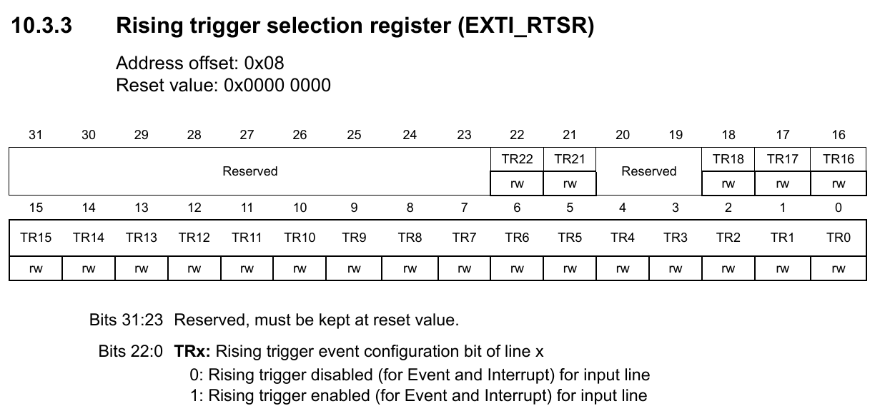
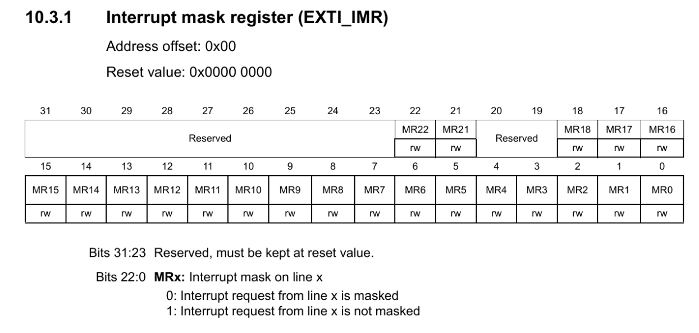

# PreLAB: External Interrupt

**Date:** 2026-10-01

**Author:** 손수현

**Demo Video:** [demo video link](https://youtube.com/shorts/lfRbL7PeyPM?feature=share)

***

## Exercise&#x20;

### A. Exercise 1: Register Configuration

**Assumption:**

`#define BUTTON_PIN PA_4 //EVAL board JKIT`

#### EXTI GPIO Pin initialization

* Push-Button: Port A Pin 4 / Input / PU

```c
GPIO_init(BUTTON_PIN, INPUT);
GPIO_pupd(BUTTON_PIN, PU);
```

#### EXTI Configuration

1. **Enable EXTI Clock with SYSCFG controller clock**

* **RCC\_APB2ENR:** SYSCFGEN

  ```c
  // SYSCFG peripheral clock enable
 	RCC->APB2ENR |= RCC_APB2ENR_SYSCFGEN;		
  ```

  <figure><figcaption></figcaption></figure>

2.**Connect EXTI to the GPIO Port\_y Pin\_x**

* **SYSCFG\_EXTICR2:** EXTIx
* Connect PA\_4(push-button) to EXTI4 line

  ```c

  	// Button: PA_4 -> EXTICR2(EXTI4)
  	// Pin 4~7: EXTICR2 // EXTICR[1]

  	SYSCFG->EXTICR[1] &= ~(0xFUL << 4);
  	SYSCFG->EXTICR[1] |=  0UL<<4;

  	// These are the same as
  	SYSCFG->EXTICR[1] &= ~SYSCFG_EXTICR2_EXTI4;  
  	SYSCFG->EXTICR[1] |= SYSCFG_EXTICR2_EXTI4_PA;
  ```

<figure><figcaption></figcaption></figure>

* **Generalize of Connecting Port y, Pin x to EXTIx**

  ```c
  // Connect EXTI to the GPIO Port_y Pin_x
	// Pin 0~3: EXTICR1 // EXTICR[0]
	// Pin 4~7: EXTICR2 // EXTICR[1]
	// Pin 8~11: EXTICR3 // EXTICR[2]
	// Pin 12~15: EXTICR4 // EXTICR[3]	
	uint32_t EXTICR_port=0;
	if		(Port == GPIOA) EXTICR_port = 0;
	else if	(Port == GPIOB) EXTICR_port = 1;
	else if	(Port == GPIOC) EXTICR_port = 2;
	else if	(Port == GPIOD) EXTICR_port = 3;
	else					EXTICR_port = 4;
	
	SYSCFG->EXTICR[pin/4] &= ~(0xFUL<<(pin%4)*4);			// clear 4 bits
	SYSCFG->EXTICR[pin/4] |= (EXTICR_port<<(pin%4)*4);			// Set 4 bits
  ```


| **Bit Starting Position** | **Pin y**      |                |                |
| ------------------------- | -------------- | -------------- | -------------- |
|                           | **EXTICR\[0]** | **EXTICR\[1]** | **EXTICR\[2]** |
| Bit 0                     | 0 (b00**00**)  | 4 (b01**00**)  | 8 (b10**00**)  |
| Bit 4                     | 1 (b00**01**)  | 5 (b01**01**)  | 9 (b10**01**)  |
| Bit 8                     | 2 (b00**10**)  | 6 (b01**10**)  | 10 (b10**10**) |
| Bit 12                    | 3 (b00**11**)  | 7 (b01**11**)  | 11 (b10**11**) |

3. **Select Trigger Edge (RISE, FALL, BOTH)**

* **EXTI\_FTSR:** TRx or **EXTI\_RTSR:** TRx

  ```c
  	// Select  Trigger edge (RISE, FALL, BOTH)
  	if (trig_type == FALL) 		EXTI->FTSR |= 1UL << pin;  // Falling trigger enable 
		else if	(trig_type == RISE) EXTI->RTSR |= 1UL << pin;   // Rising trigger enable 
		else if	(trig_type == BOTH) {			// Both falling/rising trigger enable
		EXTI->RTSR |= 1UL << pin; 
		EXTI->FTSR |= 1UL << pin;
	} 
  ```
 <p align="center">



</p>
<p align="center">


</p>

4. **Enable EXTI: Not-masking Interrupt request**

* **EXTI\_IMR:** MRx
  * Enabling == not-masking

```c
	// Enable EXTI, with Not-Masked Interrupt Request 
	// Not-mask (==Enable) EXTIx
 	EXTI->IMR |= 1UL << pin;
```

<p align="center">
  
</p>

#### EXTI\_NVIC

<table data-search="false"><thead><tr><th>EXTIx</th><th>ISR (handler)</th><th>IRQn (keyword, stm32f111xe.h)</th><th>IRQn</th></tr></thead><tbody><tr><td>EXTI0</td><td>EXTI0_IRQHandler()</td><td>EXTI0_IRQn</td><td>6</td></tr><tr><td>EXTI1</td><td>EXTI1_IRQHandler()</td><td>EXTI1_IRQn</td><td>7</td></tr><tr><td>EXTI2</td><td>EXTI2_IRQHandler()</td><td>EXTI2_IRQn</td><td>8</td></tr><tr><td>EXTI3</td><td>EXTI3_IRQHandler()</td><td>EXTI3_IRQn</td><td>9</td></tr><tr><td>EXTI4</td><td>EXTI4_IRQHandler()</td><td>EXTI4_IRQn</td><td>10</td></tr><tr><td>EXTI5_9</td><td>EXTI9_5_IRQHandler()</td><td>EXTI9_5_IRQn</td><td>23</td></tr><tr><td>EXTI10_15</td><td>EXTI15_10_IRQHandler()</td><td>EXTI15_10_IRQn</td><td>40</td></tr></tbody></table>


```c
	// NVIC(IRQ) Setting
	uint32_t EXTI_IRQn = 0;
	if (pin < 5) 		EXTI_IRQn = pin+6;
	else if	(pin < 10) 	EXTI_IRQn = EXTI9_5_IRQn;
	else 				EXTI_IRQn = EXTI15_10_IRQn;
		
	NVIC_SetPriority(EXTI_IRQn, priority);	
	NVIC_EnableIRQ(EXTI_IRQn); 				
}
```

#### EXTI\_handler

1. **Check for Pending Status**
   * **EXTI\_PR:** PRx
   * Read the bit at PRx and returns either 1 or 0

```c
uint32_t is_pending_EXTI(PinName_t pinName) {
	GPIO_TypeDef *Port;
	unsigned int pin;
	ecPinmap(pinName,&Port,&pin);

	uint32_t EXTI_PRx =  (EXTI->PR>>pin) & 1;     // read PRx, EXTI pending bit.  Use  (REG>>k & 1) to read.
	return  EXTI_PRx; 	// Return only 0 or 1
}

```

2. \*\*Clear Pending \*\*
   * **EXTI\_PR:** PRx
   * By writing '1', it clears the pending bit.

```c

void clear_pending_EXTI(PinName_t pinName){
	GPIO_TypeDef *Port;
	unsigned int pin;
	ecPinmap(pinName, &Port, &pin);

	// clear by writing 1 to the pending bit
	EXTI->PR  |= (1 << pin);     
}
```

### B. Exercise 2 : Programming


**code**

```c
/*----------------------------------------------------------------\
@ Embedded Controller by Young-Keun Kim - Handong Global University
Author           : 손수현
Created          : 05-03-2021
Modified         : 01-10-2026
Language/ver     : C++ in VS Code

Description      : Tutorial - EXTI
/----------------------------------------------------------------*/


#include "ecSTM32F4v2_22400365.h"

#define LED0_PIN   PB_12 		//EVAL board JKIT LED0
#define LED7_PIN   PC_3 		//EVAL board JKIT LED7
#define SW2_PIN    PA_4			//EVAL board JKIT SW2


void led_toggle(PinName_t pinName){
	GPIO_TypeDef *Port;    
	unsigned int pin;
	ecPinmap(pinName,&Port,&pin);
    
	Port->ODR ^= (1UL << pin);
}

// Initialiization 
void setup(void)
{
		RCC_PLL_init();                 // System Clock = 84MHz
		SysTick_init();                 // SysTick Timer Initialization
		// Initialize GPIOB_12 for Output
		GPIO_init(LED0_PIN, OUTPUT);    // LED0 for EVAL board	
		GPIO_init(LED7_PIN, OUTPUT);    // LED7 for EVAL board
		
		// Initialize GPIOA_4 for Input Button
		GPIO_init(SW2_PIN, INPUT);  // INPUT for EVAL board
		GPIO_pupd(SW2_PIN, PU);  // PULL-UP for EVAL board
		
		// Initialize EXTI PA_4
		EXTI_init(SW2_PIN, FALL, 10);		
}


// MAIN  ----------------------------------------
int main(void) {
	setup();
	while (1){
        GPIO_write(LED7_PIN, HIGH);
        delay_ms(1000);
        GPIO_write(LED7_PIN, LOW);
        delay_ms(1000);
    }
}


void EXTI4_IRQHandler(void) {
	if (is_pending_EXTI(SW2_PIN)) {   
		led_toggle(LED0_PIN);
		clear_pending_EXTI(SW2_PIN);
	}
}

```

**result**

[demo video link](https://youtube.com/shorts/lfRbL7PeyPM?feature=share)